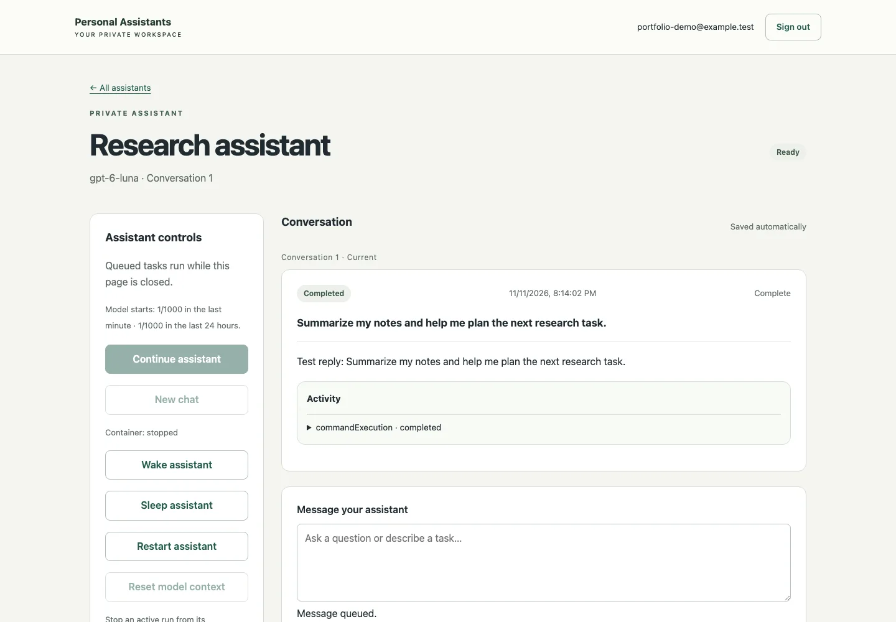

# Personal AI Assistant Platform

A browser-based platform for creating private AI assistants, chatting with them,
browsing their workspace files, and scheduling work. Built by QingPeng Lam for
EECS 498-016 Hackathon 2, using React, TypeScript, Python/FastAPI and SQLite.

This is a standalone public source snapshot of my implementation. Course slides,
staff instructions, internal planning records, private Git history, credentials,
and runtime data are excluded.



The screenshot uses synthetic test data and a simulated reply.

## Features

- Account registration and sign-in, with ownership checks on assistant resources.
- Named assistants with persistent conversations and per-assistant workspaces.
- A Codex app-server runtime in a separate Docker container for each assistant,
  controlled through the Python Codex SDK.
- Streamed activity, saved run history, Stop/Continue, and model-context reset.
- Workspace upload, listing, preview and download with path and ownership checks.
- One-time and recurring jobs; agents can create jobs through a backend MCP tool,
  and users can inspect scheduled work and its results in the browser.
- SQLite-backed run queues, events and schedules, plus container lifecycle and
  storage controls.

## Architecture

```text
React browser UI -> FastAPI -> SQLite (accounts, agents, runs, events, jobs)
                        |-> workspace file service
                        |-> scheduler -> run queue
                        |-> container manager -> per-agent Codex app server
                                                   |-> backend MCP scheduling tools
```

The trusted backend manages Docker. Agent containers do not receive its daemon
socket; the runtime uses restricted networking and persistent workspace/history
storage. See `backend/app/`, `agent/` and the Dockerfiles for the implementation.

## Local simulated demo

Requirements: Python 3.12, uv, and Node.js 22.13+ (or a compatible current version).

```sh
uv sync --frozen
npm --prefix frontend ci
```

Start the backend in one terminal:

```sh
.venv/bin/python scripts/serve-test.py --mode fake --runtime ./runtime/browser-demo
```

Start the frontend in another terminal:

```sh
npm --prefix frontend run dev
```

Open http://127.0.0.1:5173/register, register a demo account, and create an
assistant. This mode uses simulated responses labeled `Test reply:`. It does not
run a model or provide real container isolation. Accounts and files created by
this demo stay under the ignored `runtime/` directory. Use test data.

## Verification

After installing the locked dependencies and Playwright's matching Chromium:

```sh
npm --prefix frontend exec playwright install chromium
sh scripts/check-project.sh
```

Individual checks:

```sh
uv run --frozen pytest -q -m 'not real_agent'
uv run --frozen ruff check backend scripts agent/network_bridge.py
npm --prefix frontend test
npm --prefix frontend run build
npm --prefix frontend run test:e2e
```

The original project records 303 backend tests, 3 frontend tests and 24 simulated
desktop/mobile browser cases. These numbers describe a recorded development
checkpoint; the publication verification record below reports fresh checks.
Manual live acceptance covered account creation, real chat/file creation,
persistence after reload, Stop preventing a delayed write, and an agent-created
scheduled job. That historical manual check is separate from automated evidence.
`sh scripts/check-project.sh --real` deliberately exits 2: the independent full
real-runtime certification suite is incomplete.

## Actual agent runtime

The real runtime targets a Linux host with rootful Docker, XFS project quotas,
prepared named volumes and the quota helper. Docker Desktop alone is not the
validated runtime. `scripts/build-agent.sh --check-only` checks prerequisites;
it does not provision a host. Dockerfiles and `scripts/dev.sh` contain the image
and service startup implementation. `.env.example` lists configuration names
with empty credential values. Real execution needs the operator's Codex login
or a supported model-provider key and may incur provider charges.

This repository does not include credentials, cloud resources, an active public
service, or a claim of production readiness. Extended storage/recovery and fully
automated real-runtime acceptance remain incomplete.

## Public-copy verification — November 11, 2026

- 303 backend tests passed; Ruff passed.
- 3 frontend unit tests passed; TypeScript/Vite production build passed.
- 24 simulated desktop/mobile browser cases passed without retries.
- No real model calls, Docker provisioning or cloud deployment in this pass.
- Application source, tests, lockfiles and scripts match the original snapshot;
  public README, this screenshot and additional ignore rules are packaging changes.
